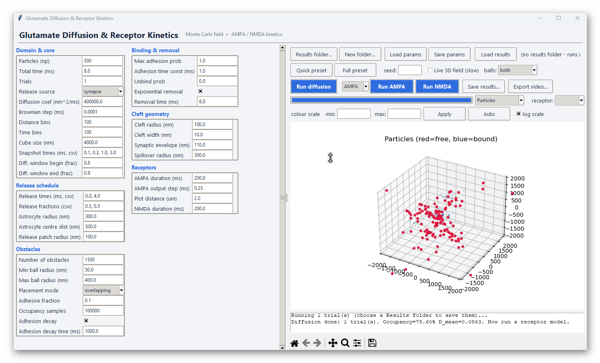

# MonteCarloSynapse

Monte Carlo simulation of glutamate diffusion in the extracellular space of
brain tissue, with AMPA- and NMDA-receptor kinetics evaluated as a function of
distance from the release site.

Glutamate molecules are released from a synaptic cleft or from an astrocytic
surface patch and perform a Brownian walk through a dense, randomly generated
population of overlapping spherical obstacles, a fraction of which are
"adhesive" (glutamate-binding, astrocyte-like). The resulting radial
concentration profiles drive the receptor kinetic schemes, shell by shell.

The code is pure Python (NumPy / SciPy / matplotlib) and runs on Windows, macOS
and Linux. No paths, drives or interpreter locations are hard-coded; every
input and output folder is given on the command line or chosen in the GUI.



## Quick start

No installation step is required: download the repository and start the GUI.

1. **Code -> Download ZIP** on GitHub (or `git clone`), then unzip it anywhere.
2. Windows: double-click **`Run_GUI.bat`**.
   macOS / Linux: run **`./run_gui.sh`** in a terminal
   (`chmod +x run_gui.sh` once, if needed).
3. The launcher finds your Python interpreter and, if `numpy`, `scipy` or
   `matplotlib` are missing, offers to install them with `pip`. Then the window
   in the screenshot above opens.
4. Press **Run diffusion**, then **Run AMPA** or **Run NMDA**.

Anything with Python 3.9 or newer works, including Anaconda. The GUI uses
Tkinter, which ships with CPython; on some Linux distributions it is a separate
package (`sudo apt install python3-tk`). Exporting a video is optional and
needs two more packages (`pip install imageio imageio-ffmpeg`); nothing else
depends on them.

## Install as a package

For scripting, or to get the `montecarlosynapse` command:

```bash
git clone https://github.com/RusakovLab/MonteCarloSynapse.git
cd MonteCarloSynapse
pip install -e .            # or, without installing: pip install -r requirements.txt
```

Run the tests:

```bash
pip install -e ".[test]"
pytest -q
```

## Command line

```bash
python run.py all --quick --out results/trial            # a complete run in seconds
python run.py diffusion --out results/run1               # Monte Carlo -> radial histograms + metadata
python run.py ampa --data results/run1 --model AMPA2     # AMPA kinetics on that run
python run.py nmda --data results/run1                   # NMDA kinetics on that run
python run.py all  --out  results/run1                   # diffusion, then every receptor model
```

After `pip install -e .` the same commands are available as
`montecarlosynapse ...` and `python -m glutamate ...`.

`--quick` substitutes a small configuration (80 particles, 60 obstacles,
0.5 ms) so that the whole pipeline finishes in seconds; it is the CLI
equivalent of the GUI's **Quick preset** and is meant for trying the workflow,
not for quantitative results. Without it the full-scale defaults apply (500
particles, 1500 obstacles, 8 ms at a 0.1 us step), which take a long time.

`--seed` makes a run reproducible. All parameters come from
`glutamate.config.default_config()`; a run's parameters are written to
`Parameters.json` in the output folder and can be reloaded from it.

## GUI

```bash
python gui.py          # or: Run_GUI.bat (Windows) / ./run_gui.sh (macOS, Linux)
```

Edit the parameters in the left panel, press **Run diffusion**, then **Run
AMPA** or **Run NMDA** on the result, and switch the view (Concentration /
Open state / Desensitization / Spillover / Particles). Long runs execute in a
background thread with a progress bar; **Save results...** writes the radial
histograms, metadata, particle snapshots and receptor state maps into a folder,
and a saved folder can be reloaded later for viewing without recomputation.
The launcher scripts discover the Python interpreter themselves (an activated
environment, a local `.venv`, `PATH`, or a per-user Anaconda install).

## Package layout

```
glutamate/
  config.py          # all parameters in one place (dataclasses)
  diffusion.py       # Monte Carlo glutamate diffusion among obstacles
  kinetics.py        # AMPA / AMPA1 / AMPA2 / NMDA ODE right-hand sides
  concentration.py   # molecule counts -> uM
  receptors_ampa.py  # spatial AMPA driver (per radial shell)
  receptors_nmda.py  # spatial NMDA driver (per radial shell)
  project.py         # parameter save/load, multi-trial runs, results folders
  io_files.py        # radial-histogram / metadata / snapshot files
  plotting.py        # figures (headless-safe, separate from computation)
  video.py           # optional MP4/GIF export of the 3D field
run.py               # command-line entry points
gui.py               # Tkinter desktop interface
tests/               # numerical and smoke tests
```

The computational functions return result objects and never depend on the
working directory, so the GUI and the CLI are thin layers over the same tested
code.

## Receptor states

Concentration handed to the kinetics is in **uM** (one molecule per um^3 is
`1e21 / N_A` = 1.6605e-3 uM). Effective binding coefficients acting on that
input: AMPA 13, AMPA1 13, AMPA2 20, NMDA 25 (/uM/ms). All four kinetic schemes
conserve total receptor probability (verified in `tests/test_kinetics.py` to
~1e-15) and relax to the unbound state when glutamate is removed.

Each receptor result carries two maps over distance and time,
`result.open_state` and `result.desensitization`, saved as
`<model> Open State.txt` and `<model> Desensitization State.txt`.

## Numerical notes

- The diffusion step is a cubic (uniform per axis) displacement with
  `StepRad = sqrt(6 * D * dt)`; obstacle containment is evaluated by chunked
  pairwise distance tests, vectorized over particles.
- Inside the synaptic cleft the axial step is reduced and reflected at the
  cleft walls; a particle counts as intracleft only when it is within the
  cleft radius **and** within the cleft half-width in z.
- Full-scale defaults (500 particles, 1500 obstacles, 8 ms, 0.1 us step) are
  heavy; `glutamate.quick_config()` (CLI `--quick`, GUI **Quick preset**) is
  the same physics at a size that runs in seconds.
- Shell volumes, radial edges and time points of each run are written to
  `SimulationMetadata*.json` and reused by the receptor drivers, so the
  concentration reconstruction does not rely on a legacy geometry.

## Provenance

The simulation originates in a MATLAB implementation
(`DiffusionGlutamateBalls.m`, `InputParametersSR.m`, `Unified_AMPA_SpaceSR.m`,
`NMDA_SpaceSR_Optimized.m`, `AMPA*.m`, `NMDA*.m`), which is preserved in the
history of this repository. The kinetics are exact ports of those files; the
diffusion Monte Carlo is a statistically faithful, vectorized port — NumPy and
MATLAB use different random number generators, so results match in
distribution rather than bit for bit.

## Citation and licence

See `CITATION.cff`. MIT licence (see `LICENSE`).
